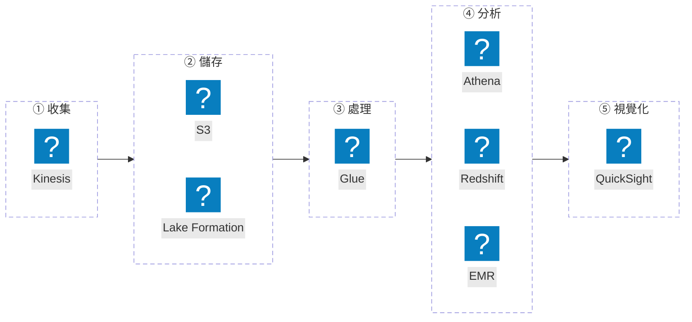

# 資料分析

Kinesis、Lake Formation、Glue、Athena、EMR、QuickSight。AI/ML 要有效，前提是有乾淨、整理好的資料——資料分析是 AI/ML 的上游基礎。這章把原始資料要走的「收集 → 儲存 → 處理 → 分析 → 視覺化」五個階段，逐一對應到 AWS 服務。

## 先備知識

- **資料分析（Data Analysis）**
  - [什麼是資料分析？（AWS）](https://aws.amazon.com/tw/what-is/data-analytics/)

- **資料湖 vs 資料倉儲（Data Lake / Data Warehouse）**
  - [資料倉儲、資料湖和資料市集之間有什麼區別？（AWS）](https://aws.amazon.com/tw/compare/the-difference-between-a-data-warehouse-data-lake-and-data-mart/)

- **ETL（Extract → Transform → Load）**
  - [什麼是 ETL？（AWS）](https://aws.amazon.com/tw/what-is/etl/)

## 為什麼資料要走「五個階段」

原始資料剛產生時，通常是**又亂又雜、不能直接拿來用**的：來自感測器的一串串數字、網站的點擊記錄、上傳的 PDF、四散各處的 log。要把這堆東西變成「老闆看得懂的報表」或「能餵給 AI 的乾淨資料」，中間得走一條路：

先把資料收進來（收集）→ 找地方存起來（儲存）→ 清洗整理成好用的格式（處理／轉換）→ 對它提問、跑分析（分析）→ 把結果畫成圖表（視覺化）。

AWS 針對這條路上的每一站，都準備了對應的服務。這章的重點不是背服務名，而是搞懂「**每個服務站在這條路的哪一站、解決哪一段的麻煩**」——每個服務的位置清楚了，考題問「這個情境該用哪個」時，答案自然就出來了。

## 典型資料管線（五階段）

```
收集 ──────→ 儲存 ───────→ 處理/轉換 ──→ 分析 ──────────→ 視覺化
Kinesis      S3 +           Glue          Athena /        QuickSight
(即時串流)   Lake Formation  (ETL)         Redshift / EMR  (儀表板)
```

> **新圖提案（待審核）** — 審核通過後取代上方的文字圖。



*資料依序經過五個階段：Kinesis 收集即時串流，存進 S3（Lake Formation 負責建置資料湖和管權限），Glue 做 ETL 並建立資料目錄，再交給 Athena、Redshift 或 EMR 分析，最後用 QuickSight 做成儀表板。*

| 服務 | 管線角色 | 一句話 |
|------|---------|--------|
| **Kinesis** | 收集 | **即時串流**資料的收集與處理（點擊流、IoT 感測器）|
| **S3 + Lake Formation** | 儲存 | 資料存在 **S3**；Lake Formation 幫你**快速建置並治理**這個資料湖 |
| **Glue** | 處理 / 轉換 | 無伺服器 **ETL**（萃取、轉換、載入）＋ 資料目錄 |
| **Athena** | 分析 | 用 **SQL 直接查詢 S3** 上的資料，完全無伺服器 |
| **EMR** | 分析 | 託管大數據框架（Hadoop / Spark），處理超大規模資料 |
| **Redshift** | 分析 | **資料倉儲**，跑複雜分析 / BI |
| **QuickSight** | 視覺化 | BI **儀表板與圖表**，把分析結果視覺化 |

## 逐一認識每個服務

### 收集｜Amazon Kinesis

**它是什麼**：專門「接住源源不絕、即時湧入的資料」的服務。想像一個新聞網站每秒有上萬人點擊、或工廠上千個感測器每秒回報溫度——這些資料**一產生就要馬上接住、不能漏**，這就是 Kinesis 的舞台。

**為什麼需要它**：傳統做法是「累積一批、之後再一次處理」（批次）；但很多場景等不了——詐騙偵測、即時儀表板、IoT 監控都要「資料一進來就處理」。Kinesis 就是這條「即時串流」的水管。

**補充**：Kinesis 其實是一個家族，CLF 只要記兩個代表——**Data Streams**（即時串流、可自訂消費端）與 **Data Firehose**（全託管，自動把串流資料「倒進」S3 / Redshift 等目的地）。

> 📌 看到「即時串流、點擊流、IoT 感測器、即時處理」→ **Kinesis**。

### 儲存｜Amazon S3 + AWS Lake Formation

**先分清楚兩者的關係**：資料**實際上是存在 S3** 裡的（S3 就是那個能裝海量、任何格式資料的「大倉庫」，也就是**資料湖**的底層）。**Lake Formation 不是另一個儲存體**，而是蓋在 S3 之上的「**建置＋管理**」工具。

**Lake Formation 幫你做什麼**：手動從零打造一個安全的資料湖很繁瑣——要設定 S3、爬梳資料、編目錄、再一項項設權限。Lake Formation 把這些整合起來，讓你**快速把資料湖建好**，並且能做到**細緻的權限控管**（誰能看哪個資料表、甚至哪些欄位）。

> 📌 「集中存放各種原始資料、建資料湖」→ 資料在 **S3**，用 **Lake Formation** 快速建置與控管權限。

### 處理／轉換｜AWS Glue

**它是什麼**：無伺服器的 **ETL** 服務——把原始資料**萃取（Extract）出來、轉換（Transform）成乾淨格式、載入（Load）到目的地**。原始資料常常髒亂（缺欄位、格式不一、混著垃圾），Glue 就是那個「幫你把資料洗乾淨、整理好」的工人，而且你不用管任何伺服器。

**一個容易被忽略、卻很關鍵的角色——Glue Data Catalog**：Glue 有個「爬蟲（Crawler）」會自動掃描 S3 裡的資料，推導出它「長什麼樣、有哪些欄位」，把這份「資料的目錄」記進 **Glue Data Catalog**。有了這份目錄，後面的 **Athena、Redshift 才知道 S3 那堆檔案該怎麼查**。所以 Glue 不只是「洗資料」，還是「幫資料湖編目錄」的人。

> 📌 「ETL / 整理轉換資料」「自動爬取 S3 結構、建立統一目錄」→ **Glue**。

### 分析｜三種不同的「分析」：Athena / EMR / Redshift

管線的「分析」階段有三個服務，初學者最容易混。它們都在做分析，但**適合的場景完全不同**：


同一份 S3 資料，三條路完全不同：輕量查詢走 Athena、重運算走 EMR、正式 BI 分析走 Redshift——選哪條看的是「查詢複雜度」與「要不要先把資料正式載入」，不是資料本身的差異。

**Amazon Athena——最輕巧的一個**。它讓你**直接用 SQL 查詢 S3 上的檔案**，不必先架資料庫、不必把資料搬進任何地方、也沒有任何伺服器要管。最典型的用法是「快速查一下 log」（例如 ALB 的存取紀錄）。計費方式是**按查詢掃描的資料量**計算，所以資料量大時常把檔案轉成壓縮的欄狀格式（如 Parquet）來省錢。

> 📌 「不想建資料庫、無伺服器、直接用 SQL 查 S3」→ **Athena**。

**Amazon EMR——最重裝的一個**。當資料大到、或處理邏輯複雜到 SQL 搞不定時（例如要跑機器學習的前處理、超大規模的資料清洗），就需要 **Hadoop / Spark** 這類大數據框架。EMR 是「幫你把這些框架的叢集託管起來」的服務——你仍要寫程式、管比較多東西，換來的是處理超大規模、超複雜運算的能力。

> 📌 「Hadoop / Spark、超大規模資料清洗」→ **EMR**。

**Amazon Redshift——資料倉儲**。當你要對**已經整理好的結構化資料**，反覆跑**複雜的商業分析與報表（BI）**——例如「過去三年各地區銷售趨勢」——就用 Redshift。它是專為這種大規模分析查詢（OLAP）打造的倉儲，資料要先載入進來，換來的是又快又強的分析能力。

> 📌 「資料倉儲、BI、對海量歷史資料跑複雜分析（OLAP）」→ **Redshift**。

### 視覺化｜Amazon QuickSight

**它是什麼**：AWS 的 **BI（商業智慧）視覺化工具**。前面辛苦分析出來的結果，如果只是一堆數字，老闆和團隊看不懂——QuickSight 把它們變成**互動式的圖表與儀表板**。它是無伺服器的，可以接上 Athena、Redshift、RDS、S3 等來源，直接把資料畫成圖。

> 📌 「做 BI 儀表板 / 把分析結果視覺化」→ **QuickSight**。

## 以電商場景為例

把這些服務串起來，看它們如何在一個真實業務裡各司其職。

情境是電商後台的發票處理：財務每天收到大量使用者上傳的發票 PDF，如果要人工一張張核對金額、登打資料，既慢又容易出錯，也沒辦法即時餵給後面的分析或推薦系統。

這條管線的重點是讓 AI 服務先把「PDF 裡的非結構化文字」轉成「乾淨的結構化資料」，存進資料湖之後，才輪到這章前面介紹的分析管線（Glue → Athena / QuickSight）接手。

整個流程（發票上傳 → AI 萃取 → 進資料湖 → ETL → 三種下游用途），拆成「AI 萃取」與「ETL 後分工」兩段看：

**AI 萃取進資料湖**：

```mermaid
architecture-beta
    group cloud(cloud)[AWS Cloud]

    service upload(server)[User Upload]
    service textract(aws:amazon-textract)[Textract] in cloud
    service comprehend(aws:amazon-comprehend)[Comprehend] in cloud
    service s3(aws:amazon-simple-storage-service-bucket)[S3] in cloud

    upload:R --> L:textract
    textract:R --> L:comprehend
    comprehend:R --> L:s3
```



Textract 從 PDF 裡萃取文字與金額，Comprehend 進一步分析內容，兩者都是**現成 AI 服務**（不用自己訓練模型）；處理完存進 S3，成為資料湖的起點。

**資料湖 ETL 後三路分工**：


S3 裡的資料先經 Glue 做 ETL，再分三路：Athena 做臨時查詢、QuickSight 出儀表板、Personalize 依購買記錄做個人化推薦。

## 重點整理

- **資料管線五段**：Kinesis（即時串流收集）→ S3 + Lake Formation（資料湖儲存）→ Glue（ETL＋資料目錄）→ Athena / Redshift / EMR（分析）→ QuickSight（視覺化）
- 即時串流 → **Kinesis**；SQL 查 S3 無伺服器 → **Athena**；ETL → **Glue**；儀表板 → **QuickSight**
- 資料實際存在 **S3**；**Lake Formation** 是快速建置資料湖＋細緻權限治理的那一層（不是儲存本身）
- **Glue Data Catalog**：Glue 爬梳 S3、建立「資料目錄」，Athena / Redshift 才知道怎麼查 S3 的資料
- 三種「分析」的差別：**Athena**（無伺服器、SQL 查 S3、臨時查詢）｜**EMR**（Hadoop/Spark、超大規模重運算）｜**Redshift**（資料倉儲、結構化資料的複雜 BI／OLAP）
- **QuickSight** = 無伺服器 BI，把分析結果變成互動式儀表板

| 情境需求 | 答案 |
|---------|------|
| 即時串流資料收集（IoT、點擊流）| **Kinesis** |
| 集中存放各種原始資料、建資料湖 | **S3 + Lake Formation** |
| 資料 ETL / 整理轉換 | **Glue** |
| 自動爬取 S3 結構、建立資料目錄 | **Glue（Data Catalog）** |
| 用 SQL 直接查 S3（無伺服器）| **Athena** |
| 超大規模 Hadoop / Spark 大數據處理 | **EMR** |
| 對結構化資料跑複雜 BI 分析（OLAP）| **Redshift** |
| BI 儀表板與視覺化 | **QuickSight** |

## 延伸閱讀

- [The Log: What every software engineer should know about real-time data's unifying abstraction](https://blog.kevinhu.me/2019/04/01/31-Blog-Reading-Kafka/) — Jay Kreps（Kafka 之父）。
