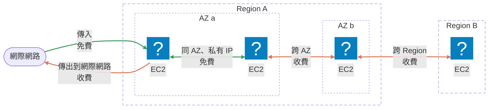
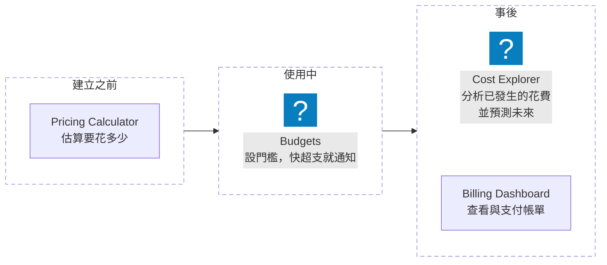

# 定價與支援

AWS 定價原則、帳單工具、支援方案與成本最佳化。這章技術最少，重點在搞懂 AWS 怎麼收費、有哪些工具幫你管錢、支援方案怎麼選。

## AWS 定價原則

AWS 的收費圍繞三個原則：

| 原則 | 意思 | 對應服務 |
|------|------|---------|
| **按用量付費（Pay-as-you-go）** | 用多少付多少，不用先砸大錢、不用長期綁約 | 大多數服務的預設 |
| **預留 / 承諾換折扣（Pay less when you reserve）** | 事先承諾 1 或 3 年用量，單價大幅下降 | Savings Plans、Reserved Instances |
| **用越多、單價越低（Volume discounts）** | 用量越大，每單位越便宜（階梯式）| S3 等的階梯定價 |

### AWS 免費方案（Free Tier）：三種

Free Tier 分三類：

| 類型 | 意思 | 例子 |
|------|------|------|
| **永久免費（Always Free）** | 不會過期，永遠有一定免費額度 | Lambda 每月 100 萬次請求、DynamoDB 25GB |
| **12 個月免費（12 Months Free）**† | 新帳號註冊後 12 個月內免費 | EC2 t2.micro 每月 750 小時、S3 5GB |
| **短期試用（Trials）** | 特定服務從啟用日起算的短期試用 | 某些服務的數十天試用 |

> EC2 的免費額度是「**12 個月**」的，不是永久；Lambda / DynamoDB 那種小額度才是「**永久免費**」。

> † 2025/7/15 起 Free Tier 制度異動（新帳號）：「12 個月免費」對 **2025/7/15（含）之後建立的帳號已取消**，改為額度制——註冊即得 $100，完成 5 項任務（EC2 / RDS / Lambda / Bedrock / Budgets 各 $20）可追加 $100，合計上限 $200。永久免費（Always Free）服務則不受影響。

### 三大成本來源

帳單主要來自三件事：

- **運算（Compute）**：跑 EC2 / Lambda 等的時間與規格，通常最大宗
- **儲存（Storage）**：存在 S3 / EBS 等的資料量
- **資料傳輸（Data Transfer）**：傳入（IN）通常免費；傳出（OUT）到網際網路才收費——把資料「搬進」AWS 多半不用錢，「搬出去」才要錢

> **新圖提案（待審核）** — 新增的圖，不取代任何內容。注意：上一行寫「傳出（OUT）到網際網路才收費」，和這張圖不一致（跨 AZ、跨 Region 也收費），審核時請一併決定是否修改那一行。

*綠線免費、橘線收費。資料傳入 AWS 通常免費；傳出到網際網路、跨 Region、同一個 Region 內跨 AZ 都要收費；同一個 AZ 內用私有 IP 互傳則免費。*

## 定價與帳單服務

分清楚「哪個工具在哪個時間點用」：

| 服務 | 在「什麼時間點」用 | 做什麼 |
|------|------------------|--------|
| **AWS Pricing Calculator** | **建立之前** | 估算「如果我這樣建，大概多少錢」|
| **AWS Billing Dashboard** | 事後 | 查看與支付帳單 |
| **AWS Cost Explorer** | 事後 | **視覺化、分析**已發生的花費趨勢，並依歷史用量**預測**未來花費 |
| **AWS Budgets** | 持續 | 設**預算門檻**，接近 / 超過就**發通知** |
| **Consolidated Billing**（透過 Organizations）| 持續 | 多帳號合併一張帳單，並合併用量享量大折扣 |

> - 「**還沒建、想先估價**」→ **Pricing Calculator**
> - 「分析**過去 / 現在**的花費、找趨勢」→ **Cost Explorer**
> - 「設**門檻**，快超支就**通知我**」→ **Budgets**
>
> 📌 **Calculator 估還沒建的；Cost Explorer 分析已發生的花費，並依歷史用量預測未來；Budgets 守門檻。**

> **新圖提案（待審核）** — 新增的圖，不取代任何內容。

*這幾個工具最大的差別是使用的時間點：還沒建之前用 Pricing Calculator 估價，使用中用 Budgets 盯著門檻，事後用 Cost Explorer 分析花費、預測趨勢，用 Billing Dashboard 查看與支付帳單。*

**Consolidated Billing（合併帳單）怎麼運作**：

多個帳號的用量匯進 Organizations 合併成一張帳單，用量還會**加總**——單一帳號可能達不到量大折扣的門檻，合併起來就達得到，這是擁有多個帳號的企業使用合併帳單的主要誘因。

## AWS 支援方案（Support Plans）

> **重要時效提醒**：AWS 支援方案**正在改版**。
> - **現行五階**（Basic / Developer / Business / Enterprise On-Ramp / Enterprise）持續供應**到 2026/12/31**。
> - **2027/1/1 起**，Developer、Business、Enterprise On-Ramp 將終止；更新為 Basic / Business Support+ / Enterprise / Unified Operations。
> - **但目前的 CLF-C02 考試仍以「傳統五階」命題**——考試請記下面的五階版本。

### 傳統五階（考試版）

| 方案 | 費用 | 商業關鍵問題回應時間 | 招牌特色 |
|------|------|---------------------|---------|
| **Basic** | **免費** | — | 帳號 / 帳單支援、文件、有限 Trusted Advisor、Health Dashboard |
| **Developer** | 付費（低）| 一般 < 24h（上班時間 email）| 入門 / 測試用，問 Cloud Support Associate |
| **Business** | 付費 | 生產系統受損 < 4h、停擺 < 1h（24/7 電話 / chat）| **完整 Trusted Advisor**、24/7 技術支援、Support API |
| **Enterprise On-Ramp** | 付費 | 商業關鍵 **< 30 min** | **TAM 池**（一群 TAM）、成本最佳化工作坊 |
| **Enterprise** | 付費（高）| 商業關鍵 **< 15 min** | **專屬 TAM**、Concierge 帳務協助、Well-Architected review |

**TAM**（Technical Account Manager，技術客戶經理）：AWS 指派給你、熟悉你環境的專屬技術聯絡窗口。

> 「需要一位**專屬 TAM**」→ Enterprise（On-Ramp 只有「TAM 池」，不是專屬）
>
> 24/7 電話 / chat 支援 + 完整 Trusted Advisor → Business 以上才有

## AWS Marketplace 與合作夥伴

| 資源 | 是什麼 |
|------|--------|
| **AWS Marketplace** | 數位軟體商店：找、買、快速部署**第三方軟體**到你的 AWS 環境（如現成的防火牆、資料庫映像）|
| **AWS Partner Network（APN）** | AWS 的**合作夥伴**生態系：**諮詢夥伴**（幫你規劃 / 建置 / 遷移）與**技術夥伴**（提供軟體 / 工具）|

> 「快速取得 / 部署**第三方商業軟體**」→ **AWS Marketplace**
>
>「需要**外部顧問**幫忙上雲」→ **AWS Partner Network**。

## 成本最佳化實務

- **選對計費模式**：穩定負載用 Savings Plans / Reserved；可中斷工作用 Spot；短期不確定用 On-Demand
- **Right-sizing**：用 CloudWatch 指標檢視使用率，別開過大的機器
- **刪閒置資源**：沒在用的 EC2、沒掛載的 EBS、沒關聯的 Elastic IP → 用 Trusted Advisor 的成本最佳化檢查揪出來
- **儲存分層**：S3 生命週期政策自動把冷資料移到便宜類別
- **彈性擴展**：Auto Scaling 隨需求增減，不用照尖峰常備
- **合併帳單**：用 Consolidated Billing 把用量集中起來，達到量大折扣的門檻

## 重點整理

| 情境需求 | 答案 |
|---------|------|
| 還沒建，先估算成本 | **Pricing Calculator** |
| 分析過去 / 現在花費趨勢 | **Cost Explorer** |
| 設預算門檻、快超支就通知 | **AWS Budgets** |
| 多帳號一張帳單 + 量大折扣 | **Consolidated Billing**（Organizations）|
| 需要一位「專屬 TAM」 | **Enterprise** 支援方案 |
| 只需帳單 / 帳號協助、免費 | **Basic** 支援方案 |
| 需要 24/7 技術支援 + 完整 Trusted Advisor | **Business**（含）以上 |
| 取得 / 部署第三方商業軟體 | **AWS Marketplace** |
| 找顧問幫忙上雲 | **AWS Partner Network** |
