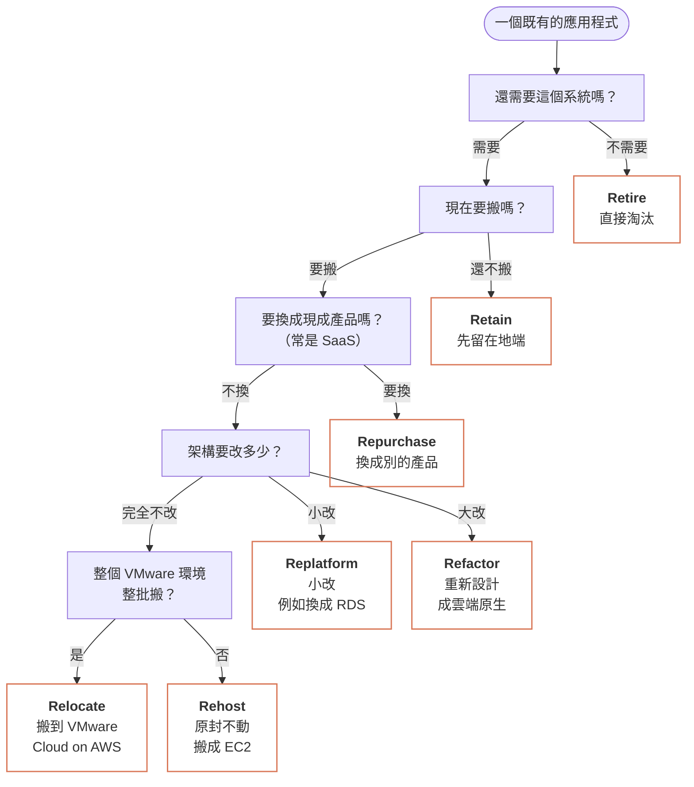
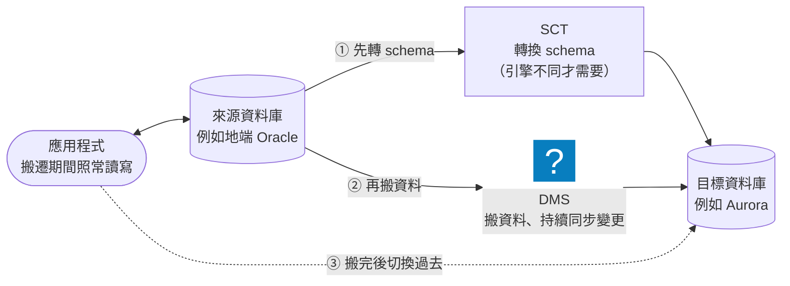
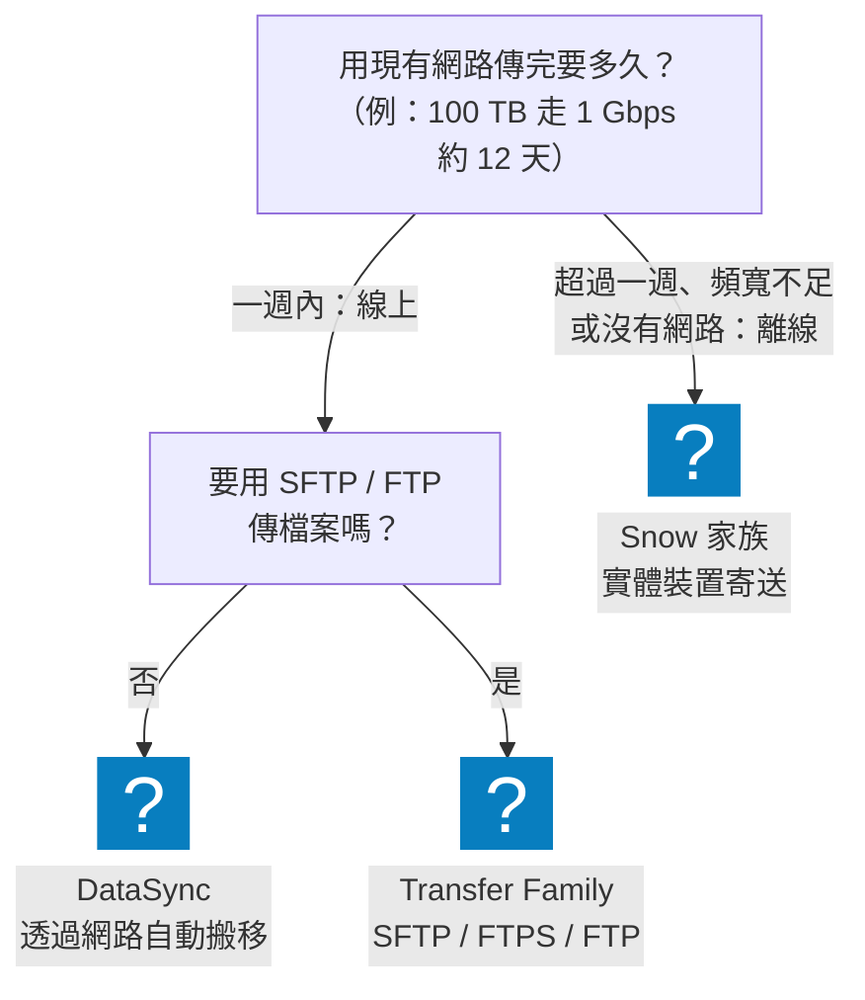

# 遷移上雲

雲端採用框架、七大遷移策略、資料庫與資料搬移工具。這章講「怎麼把既有的系統與資料從地端搬到 AWS」——重點是**規劃框架（CAF）**、**七種搬法（7R）**，以及線上 / 離線搬資料的工具怎麼選。

## 為什麼遷移需要框架與策略

把一整間公司的系統搬上雲，牽涉到組織、技能、安全、成本、相依關係——不是「複製貼上」這麼簡單。所以 AWS 提供兩個工具幫你想清楚：**CAF（規劃的框架）** 與 **7R（每個應用怎麼搬的策略）**。

## AWS 雲端採用框架（Cloud Adoption Framework, CAF）

CAF 幫組織**有系統地規劃與執行上雲**，從六個面向檢視組織準備好了沒。六個面向分成兩組：

**商業能力（Business Capabilities）— 先想清楚「為什麼、誰來做」：**

| 面向 | 關注什麼 |
|------|---------|
| **Business（商業）** | 確保雲端投資**對齊商業目標** |
| **People（人員）** | 角色、技能、組織結構、教育訓練、變革管理 |
| **Governance（治理）** | 管理與衡量雲端投資、專案 / 投資組合管理 |

**技術能力（Technical Capabilities）— 再處理「怎麼建、怎麼守、怎麼跑」：**

| 面向 | 關注什麼 |
|------|---------|
| **Platform（平台）** | 建立 / 現代化雲端平台與架構 |
| **Security（安全）** | 達成安全與合規目標 |
| **Operations（營運）** | 執行、監控、維運雲端工作負載 |

> 前三個（商業 / 人員 / 治理）偏「人與管理」，後三個（平台 / 安全 / 營運）偏「技術與執行」。

## 七大遷移策略（The 7 Rs）

每一個既有應用程式，可以選七種搬法之一：

| 策略 | 做什麼 | 例子 |
|------|--------|------|
| **Rehost** | 原封不動搬上雲，不改架構（最快）| 把地端 VM 直接複製成 EC2 |
| **Replatform** | 搬上雲時做小幅最佳化，不動核心架構 | 把自管 MySQL 換成託管 **RDS** |
| **Refactor / Re-architect** | 重新設計成雲端原生（最費工、效益最大）| 把單體應用改成微服務 + 無伺服器 |
| **Repurchase** | 換成另一個產品，常是 SaaS | 自架 CRM → 改用 Salesforce |
| **Retain** | 暫時保留在地端（還沒準備好 / 沒必要搬）| 即將汰除、或有相依限制的系統 |
| **Retire** | 直接淘汰、移除不再需要的東西 | 關掉沒人用的舊系統，省成本 |
| **Relocate** | 把基礎設施整批搬到雲、不買新硬體、不改程式 | VMware Cloud on AWS |

> - 「原封不動、最快搬上雲」→ **Rehost**
> - 「搬上雲順便換成託管服務（如 RDS）但不大改」→ **Replatform**
> - 「重新設計成雲端原生、投入最多」→ **Refactor**
> - 「換成 SaaS / 別的產品」→ **Repurchase**
> - 「這個系統先不搬」→ **Retain**
> - 「這個系統不要了」→ **Retire**

> **新圖提案（待審核）** — 新增的圖，不取代任何內容。



*依序回答問題就能走到對應的策略。最後一題「架構要改多少」分三種：完全不改是 Rehost（如果是整個 VMware 環境整批搬，則是 Relocate），小改是 Replatform，大改是 Refactor。*

## 遷移服務與工具

| 服務 | 做什麼 |
|------|--------|
| **AWS Migration Hub** | **集中追蹤**遷移進度的儀表板（跨各種遷移工具一覽）|
| **AWS Application Migration Service（MGN）** | 自動化 **lift-and-shift（Rehost）**，把地端伺服器複製到 AWS |
| **AWS Application Discovery Service** | **盤點**地端伺服器與相依關係，協助規劃遷移 |

## 資料庫遷移

| 服務 | 做什麼 |
|------|--------|
| **AWS DMS（Database Migration Service）** | 把資料庫搬到 AWS，**搬遷期間來源資料庫仍可運作**（降低停機）|
| **AWS SCT（Schema Conversion Tool）** | 來源與目標是**不同引擎**時，先**轉換 schema** |

- **同質遷移（Homogeneous）**：來源與目標**同引擎**（MySQL → MySQL）→ 直接用 **DMS**
- **異質遷移（Heterogeneous）**：來源與目標**不同引擎**（Oracle → Aurora）→ 先用 **SCT 轉換 schema**，再用 **DMS** 搬資料

> **新圖提案（待審核）** — 新增的圖，不取代任何內容。



*引擎不同時，先用 SCT 把 schema（資料表結構）轉成目標引擎的格式，再用 DMS 搬資料；引擎相同就跳過 SCT，直接用 DMS。DMS 搬的期間會持續同步來源的新變更，應用程式照常讀寫來源資料庫，搬完再切換過去，停機時間降到最低。*

## 搬移資料：線上 vs 離線

先問關鍵問題：**網路頻寬夠不夠？**

```
資料量 vs 頻寬
  頻寬充足、可接受傳輸時間  → 線上（走網路）
  頻寬不足 / 資料量巨大 / 偏遠無網路 → 離線（實體裝置寄送）
```

如果用現有網路傳要超過一週，就該考慮離線。例如 100TB 走 1Gbps 線路約要 12 天——這種情況改用 Snow 裝置寄送會更快。

> **新圖提案（待審核）** — 審核通過後取代上方的文字圖（例子已收進圖裡）。



*先估算用現有網路傳完要多久。一週內傳得完就走線上：一般搬移用 DataSync，要用 SFTP / FTP 傳檔就用 Transfer Family。超過一週、頻寬不足或現場沒有網路，就改用 Snow 家族的實體裝置寄送。*

### 線上傳輸

| 服務 | 做什麼 |
|------|--------|
| **AWS DataSync** | 自動化透過**網路**搬移大量資料（地端 ↔ AWS、或 AWS 儲存服務之間）|
| **AWS Transfer Family** | 用 **SFTP / FTPS / FTP** 把檔案傳進 / 傳出 S3、EFS |
| **AWS Storage Gateway** | 混合雲：地端 ↔ 雲端儲存的橋|

### 離線傳輸：AWS Snow 家族

| 裝置 | 容量級距 | 招牌特徵 |
|------|---------|---------|
| **Snowcone** | 最小（8TB HDD / 14TB SSD）| 最輕最可攜，**空間受限 / 嚴苛環境** |
| **Snowball Edge** | TB ~ PB | 主力；分 Storage Optimized / Compute Optimized；**可在裝置上跑 EC2 / Lambda 做邊緣運算** |
| **Snowmobile** | Exabyte 級（最高 100PB）| 一台貨櫃車，搬整個資料中心 |

- 「小、可攜、嚴苛環境」→ **Snowcone**
- 「幾十 TB ~ PB、頻寬不足」→ **Snowball Edge**
- 「EB 級 / 搬整座資料中心」→ **Snowmobile**

> † Snowmobile（貨櫃車）已於 2024 年退役。Snowcone 已於 2024/11 停售。

## 重點整理

| 情境需求 | 答案 |
|---------|------|
| 有系統地規劃整體上雲（六面向）| **Cloud Adoption Framework（CAF）** |
| 原封不動、最快搬上雲 | **Rehost**（lift and shift）|
| 搬上雲順便換成 RDS 等託管、不大改 | **Replatform** |
| 重新設計成雲端原生 | **Refactor / Re-architect** |
| 換成 SaaS / 別的產品 | **Repurchase** |
| 這系統先不搬 / 不要了 | **Retain** / **Retire** |
| 集中追蹤遷移進度 | **Migration Hub** |
| 自動化把伺服器複製上雲（Rehost）| **Application Migration Service（MGN）** |
| 搬資料庫、來源不能停太久 | **DMS** |
| 來源與目標資料庫引擎不同 | **SCT**（轉 schema）+ DMS |
| 透過網路搬大量資料 | **DataSync** |
| 用 SFTP 傳檔案進 S3 | **Transfer Family** |
| 頻寬不足 / 資料量巨大，離線搬 | **Snow 家族（Snowball Edge）** |
