# 訊息與佇列：SQS 與 SNS

訊息服務要解決的問題很單純：一個應用程式拆成多個獨立元件後，元件之間需要一種可靠且互不干擾的通訊機制。
## 先備知識

- **耦合性（Coupling）**
  - [iThome：Coupling 耦合](https://ithelp.ithome.com.tw/articles/10363056)
  - [Day-05: 耦合性三大原則 ADP、SDP、SAP](https://medium.com/marklin-hehe/day-05-%E8%80%A6%E5%90%88%E6%80%A7%E4%B8%89%E5%A4%A7%E5%8E%9F%E5%89%87-adp-sdp-sap-3568850ee3d8)

- **生產者－消費者模式（Producer-Consumer Pattern）**
  - [iThome：Day 28 介紹 Producer Consumer 模式](https://ithelp.ithome.com.tw/articles/10209296)
  - [Medium：Java Concurrency — 生產者消費者模式，解耦合的極致](https://medium.com/bucketing/java-concurrency-producer-and-consumer-%E7%94%9F%E7%94%A2%E8%80%85%E6%B6%88%E8%B2%BB%E8%80%85%E6%A8%A1%E5%BC%8F-%E8%A7%A3%E8%80%A6%E5%90%88%E7%9A%84%E6%A5%B5%E8%87%B4-3acd2559d5cc)

## 為什麼需要訊息服務

「耦合」是指元件之間互相依賴的程度。現代應用架構的演進，主要就是在降低元件之間的耦合：

- **緊耦合（常見於 Monolithic 單體式架構）**：元件之間**直接同步呼叫**。A 呼叫 B 之後，必須停下來等 B 回應。如果 B 故障或變慢，A 也會跟著卡住，問題容易沿呼叫鏈連鎖擴散，導致整體服務中斷。
- **鬆耦合（常見於 Microservices 微服務架構）**：元件之間改用**非同步訊息**溝通。A 只要把訊息放進佇列或主題，就能繼續做自己的事，不必等待回應。A 也不需要知道訊息由誰處理、什麼時候處理、怎麼處理，所以兩個元件彼此獨立。

下面用「上游」指送出訊息的元件，「下游」指接收並處理訊息的元件。元件解耦之後，有兩個好處：

1. **故障隔離（Fault Isolation）**：下游元件暫時無法使用時，訊息會先留在佇列裡，等下游恢復後再繼續處理。**上游完全不受影響。**
2. **負載緩衝（Load Leveling）**：上游流量突然暴增時，訊息先進入佇列排隊，下游再**照自己的速度一筆一筆處理**，不會因為瞬間湧入大量訊息而過載。

在 AWS 上，實現鬆耦合架構的兩個核心服務就是 SQS 和 SNS。

## 以電商「結帳」為例

顧客送出訂單後，後端會同時做兩件事：

```
① 把訂單寫入 SQS 佇列 ──→ 倉儲系統照自己的速度，一筆一筆取出處理
   （一秒湧入上萬筆訂單時，佇列負責緩衝，倉儲系統不會過載）
   效果：負載緩衝 + 故障隔離

② 把「訂單成立」事件發布到 SNS 主題 ──→ 同時推送給多個下游訂閱者
   （寄確認信、通知財務系統、通知物流）
   效果：一對多 fan-out
```

**簡單說，SQS 把一個任務交給一個消費者，並確保每則訊息都會被處理；SNS 把一個事件同時廣播給多個接收者。**

## Amazon SQS（Simple Queue Service）

SQS 採用**拉取（Pull）模型**。訊息進入佇列後排隊等待；消費者準備好時，主動向佇列發出 poll 請求取得訊息，處理完成後才把訊息從佇列刪除。這種設計確保每則訊息至少被處理一次，且消費者的處理速率不受上游產生訊息的速率影響。

```mermaid
architecture-beta
    group cloud(cloud)[AWS Cloud]

    service producer(server)[Producer]
    service queue(aws:amazon-simple-queue-service-queue)[SQS Queue] in cloud
    service consumer(server)[Consumer]

    producer:R --> L:queue
    queue:R --> L:consumer
```



在 SQS 裡，主動的一方是消費者：消費者自己決定什麼時候來拿訊息，拿到才處理，處理完才刪除。

| 機制 | 說明 |
|---|---|
| **訊息保留期限** | 訊息最長保留 **14 天**（預設 4 天），等消費者來取 |
| **可見性逾時（Visibility Timeout）** | 消費者取出訊息後，這則訊息會暫時隱藏，避免其他消費者重複領取。消費者處理完要刪除訊息；如果時間到了還沒刪除，訊息會重新出現在佇列中，讓其他消費者再試一次 |
| **死信佇列（Dead-Letter Queue, DLQ）** | 訊息達到最大重試次數後仍處理失敗，自動移入 DLQ 隔離，便於後續診斷與排查 |

**佇列類型：**

| 類型 | 特性 |
|---|---|
| **Standard** | 吞吐量近乎無限；會盡量維持順序，但偶爾會亂序，也可能出現極少數重複訊息 |
| **FIFO（先進先出）** | 嚴格保證訊息順序，每則訊息只會被處理一次（Exactly-Once Processing） |

## Amazon SNS（Simple Notification Service）

SNS 採用**發布 / 訂閱（Pub/Sub）模型**。發布者把訊息送到一個**主題（Topic）**，SNS 會立刻把訊息**推送（Push）給所有訂閱者**。一則訊息同時送給多個接收者，這種一對多的通訊方式稱為 fan-out。

**支援的訂閱者類型：** Email、SMS 簡訊、HTTP/S 端點、AWS Lambda、SQS 佇列、行動裝置推播（APNs / FCM）。

```mermaid
architecture-beta
    group cloud(cloud)[AWS Cloud]

    service publisher(server)[Publisher]
    service sns(aws:amazon-simple-notification-service-topic)[SNS Topic] in cloud
    junction j in cloud
    service email(aws:amazon-simple-notification-service-email-notification)[Email] in cloud
    service lambda(aws:aws-lambda-lambda-function)[AWS Lambda] in cloud
    service sqs(aws:amazon-simple-queue-service-queue)[SQS Queue] in cloud

    publisher:R --> L:sns
    sns:R --> L:j
    j:T --> L:email
    j:R --> L:lambda
    j:B --> L:sqs

    align column email lambda sqs
```



*收到訊息後，Email 寄出訂單確認信，AWS Lambda 執行後續的自動化流程，SQS 佇列則把訊息交給下游系統，以非同步方式處理。發布者只發布一次，所有訂閱者都會同時收到。*

## SQS vs SNS 對照

| | **Amazon SQS（佇列）** | **Amazon SNS（發布訂閱）** |
|---|---|---|
| 通訊模型 | 佇列：訊息排隊，等消費者來取 | Pub/Sub：一發布就送給所有訂閱者 |
| 訊息流向 | 消費者主動拉取（Poll） | SNS 主動推送（Push）給訂閱者 |
| 接收者數量 | 通常**一個**消費者處理一則訊息 | **一對多**，所有訂閱者同時接收 |
| 典型用途 | 任務佇列、緩衝突發流量、確保訊息不遺漏 | 事件通知（Email/SMS）、一個事件觸發多個下游動作 |

---

## Fan-out 模式（SNS + SQS）

這種模式用 **SNS 把同一個事件推送到多個 SQS 佇列**。每個下游系統都有自己的佇列，可以**照自己的速度處理，彼此不受影響**。


*圖中的三個佇列，分別屬於倉儲系統、財務系統和資料分析管線。SNS 只發布一次，三個佇列各自收到一份副本，再分別取出處理。*

為什麼不讓 SNS 直接推送給各個下游系統，而要在中間加上 SQS？因為佇列可以**緩衝**訊息，也可以**重試**。如果某個下游系統暫時無法使用，訊息會一直留在它的佇列裡，等系統恢復後再繼續處理。其他下游系統則完全不受影響。

## 重點整理

- **SQS = 拉取、點對點、一則訊息由一個消費者處理（任務緩衝）**；**SNS = 推送、Pub/Sub、一對多同時分發（事件廣播）**。
- 兩者都用來建立**鬆耦合**架構，帶來**故障隔離**與**負載緩衝**兩個好處。
- **SQS**：訊息最長保留 14 天；**可見性逾時**避免重複處理；**DLQ** 隔離一直處理失敗的訊息；**Standard**（高吞吐、盡量維持順序）vs **FIFO**（嚴格順序、Exactly-Once Processing）。
- **SNS 訂閱者**：Email / SMS / HTTP-S / **Lambda** / **SQS** / 行動推播。

| 情境需求 | 答案 |
|---|---|
| 任務排隊、確保每則訊息都被處理 | **SQS** |
| 突發流量湧入，需緩衝避免下游過載 | **SQS** |
| 訊息處理順序不可錯亂 | **SQS FIFO** |
| 單一訊息同時通知多個接收者 | **SNS** |
| 訂單成立後同時通知倉儲、財務、Email | **SNS（fan-out）** |
| 廣播事件且每個下游需獨立緩衝與重試 | **SNS + 多個 SQS（fan-out 組合）** |
| 持續處理失敗的訊息需隔離排查 | **死信佇列（DLQ）** |

## 延伸閱讀

- **事件驅動架構（Event-Driven Architecture）**
  - [AWS：What is Event-Driven Architecture?](https://aws.amazon.com/what-is/eda/)

- **訊息服務怎麼選：SQS / SNS / EventBridge（與 Amazon MQ）**
  - [AWS 決策指南：Amazon SQS, SNS, or EventBridge?](https://docs.aws.amazon.com/decision-guides/latest/sns-or-sqs-or-eventbridge/sns-or-sqs-or-eventbridge.html)
  - [SQS｜SNS｜AWS MQ｜Kinesis 比較](https://hyuyu1544.medium.com/aws-saa-sqs-sns-aws-mq-kinesis-streams-%E6%AF%94%E8%BC%83-f8d05bbed6fb)

- [Enterprise Integration Patterns](https://www.enterpriseintegrationpatterns.com/)（Gregor Hohpe）：訊息式架構的經典。
