```mermaid
architecture-beta
    group cloud(cloud)[AWS Cloud]

    service producer(server)[Producer]
    service queue(aws:amazon-simple-queue-service-queue)[SQS Queue] in cloud
    service consumer(server)[Consumer]

    producer:R --> L:queue
    queue:R --> L:consumer
```

# 訊息與佇列：SQS 與 SNS

當應用程式拆分為多個獨立元件，元件之間需要一種**可靠且互不干擾**的通訊機制——這正是訊息服務解決的核心問題。

## 先備知識

- **耦合性（Coupling）**
  - [iThome：Coupling 耦合](https://ithelp.ithome.com.tw/articles/10363056)
  - [Day-05: 耦合性三大原則 ADP、SDP、SAP](https://medium.com/marklin-hehe/day-05-%E8%80%A6%E5%90%88%E6%80%A7%E4%B8%89%E5%A4%A7%E5%8E%9F%E5%89%87-adp-sdp-sap-3568850ee3d8)

- **生產者－消費者模式（Producer-Consumer Pattern）**
  - [iThome：Day 28 介紹 Producer Consumer 模式](https://ithelp.ithome.com.tw/articles/10209296)
  - [Medium：Java Concurrency — 生產者消費者模式，解耦合的極致](https://medium.com/bucketing/java-concurrency-producer-and-consumer-%E7%94%9F%E7%94%A2%E8%80%85%E6%B6%88%E8%B2%BB%E8%80%85%E6%A8%A1%E5%BC%8F-%E8%A7%A3%E8%80%A6%E5%90%88%E7%9A%84%E6%A5%B5%E8%87%B4-3acd2559d5cc)

## 為什麼需要訊息服務

現代應用架構的演進路徑，本質上是一場降低耦合的工程：

- **緊耦合（常見於 Monolithic 單體式架構）**：元件之間**直接同步呼叫**——A 呼叫 B 時必須停下來等 B 立即回應。一旦 B 故障或反應變慢，A 也會跟著卡住，問題容易沿呼叫鏈連鎖擴散，導致整體服務中斷。
- **鬆耦合（常見於 Microservices 微服務架構）**：元件之間改用**非同步訊息**傳遞——A 只需把訊息丟進佇列或主題就能繼續做自己的事，不必等待回應，也不需要知道是誰、何時、用什麼方式處理，彼此相互獨立、不直接綁定。

將元件解耦後，架構獲得兩個特性：

1. **故障隔離（Fault Isolation）**：下游元件不可用時，訊息暫存於佇列，待其恢復後繼續處理，**不影響上游的正常運行**。
2. **負載緩衝（Load Leveling）**：上游流量驟增時，訊息先進入佇列排隊，下游**依自身處理速率逐一消化**，不會因瞬間流量峰值而過載。

SQS 與 SNS 是實現鬆耦合架構的兩個核心服務。

## 以電商「結帳」為例

顧客送出訂單，後端同時觸發兩條路徑：

```
① 訂單寫入 SQS 佇列 ──→ 倉儲系統依自身速率逐一取出處理
   （一秒湧入萬筆訂單時，佇列作為緩衝，倉儲系統不因此過載）
   → 負載緩衝 + 故障隔離

② 發布「訂單成立」事件至 SNS 主題 ──→ 同時推送給多個下游訂閱者
   （寄送確認信、通知財務系統、通知物流）
   → 一對多 fan-out
```

**SQS 處理「單一任務交付單一消費者、確保每則訊息都被處理」；SNS 處理「單一事件同步廣播至多個接收者」。**

## Amazon SQS（Simple Queue Service）

採用**拉取（Pull）模型**：訊息進入佇列排隊，消費者在就緒時主動發起 poll 請求取得訊息，處理完成後才從佇列刪除。這種設計確保**每則訊息至少被處理一次**，且消費者的處理速率不受上游產生速率影響。



訊息進佇列後排隊等待；消費者才是主動的一方，自己決定什麼時候發 poll 請求來拿，拿到才處理、處理完才刪除——這就是「拉取（pull）」：佇列不會主動把訊息推給任何人，跟下面 SNS 的「推送(push)」剛好相反。

| 機制 | 說明 |
|---|---|
| **訊息保留期限** | 訊息最長保留 **14 天**（預設 4 天），待消費者取用 |
| **可見性逾時（Visibility Timeout）** | 訊息被取出後進入隱藏狀態，防止其他消費者重複領取；處理完成確認後才正式刪除 |
| **死信佇列（Dead-Letter Queue, DLQ）** | 訊息達到最大重試次數後仍處理失敗，自動移入 DLQ 隔離，便於後續診斷與排查 |

**佇列類型：**

| 類型 | 特性 |
|---|---|
| **Standard** | 近乎無限吞吐量；盡力維持順序，允許偶發的亂序與極少數重複訊息 |
| **FIFO（先進先出）** | 嚴格保證訊息順序，且避免佇列中出現重複訊息（Exactly-Once Delivery，僅傳遞一次 |

## Amazon SNS（Simple Notification Service）

採用**發布 / 訂閱（Pub/Sub）模型**：發布者將訊息送至**主題（Topic）**，SNS 立即以**推送（Push）**方式將訊息**同時分發至所有訂閱者**，實現一對多的 fan-out 通訊。

**支援的訂閱者類型：** Email、SMS 簡訊、HTTP/S 端點、AWS Lambda、SQS 佇列、行動裝置推播（APNs / FCM）。

```mermaid
architecture-beta
    group cloud(cloud)[AWS Cloud]

    service publisher(server)[Publisher]
    service sns(aws:amazon-simple-notification-service-topic)[SNS Topic] in cloud
    junction j in cloud
    service email(aws:amazon-simple-notification-service-email-notification)[Email] in cloud
    service lambda(aws:aws-lambda-lambda-function)[AWS Lambda] in cloud
    service sqs(aws:amazon-simple-queue-service-queue)[SQS Queue] in cloud

    publisher:R --> L:sns
    sns:R --> L:j
    j:T --> L:email
    j:R --> L:lambda
    j:B --> L:sqs

    align column email lambda sqs
```



*Email 寄送訂單確認信；AWS Lambda 觸發後續自動化流程；SQS 佇列轉交下游系統非同步處理。單一發布，所有訂閱者同步接收。*

## SQS vs SNS 對照

| | **Amazon SQS（佇列）** | **Amazon SNS（發布訂閱）** |
|---|---|---|
| 通訊模型 | 佇列：訊息排隊等候消費 | Pub/Sub：發布即分發至所有訂閱者 |
| 訊息流向 | 消費者主動拉取（Poll） | SNS 主動推送（Push）至訂閱者 |    
| 接收者數量 | 通常**一個**消費者處理一則訊息 | **一對多**，所有訂閱者同時接收 |
| 典型用途 | 任務佇列、突發流量緩衝、確保訊息不遺漏 | 事件通知（Email/SMS）、一個事件觸發多個下游動作 |

---

## Fan-out 模式（SNS + SQS）

以 **SNS 將單一事件推送至多個 SQS 佇列**，每個下游系統擁有獨立佇列，**各自按自身速率處理、互不干擾**。


*倉儲系統、財務系統、數據分析管線各自的佇列。單次發布；三個佇列各保有一份副本，各自獨立消費（Consume）。*

為何不讓 SNS 直接推送至各下游系統，而要中間插入 SQS？因為佇列同時提供了**緩衝**與**重試**能力——某個下游暫時不可用時，訊息持續保留在其佇列中，待服務恢復後繼續處理，對其他下游系統完全無影響。

## 重點整理

- **SQS = 拉取、點對點、一則訊息由一個消費者處理（任務緩衝）**；**SNS = 推送、Pub/Sub、一對多同步分發（事件廣播）**。
- 兩者皆為**鬆耦合**架構工具，共同帶來**故障隔離**與**負載緩衝**兩項架構優勢。
- **SQS**：訊息最長保留 14 天；**可見性逾時**防止重複消費；**DLQ** 隔離持續失敗的訊息；**Standard**（高吞吐、盡力排序）vs **FIFO**（嚴格順序、Exactly-Once Delivery）。
- **SNS 訂閱者**：Email / SMS / HTTP-S / **Lambda** / **SQS** / 行動推播。

| 情境需求 | 答案 |
|---|---|
| 任務排隊、確保每則訊息都被處理 | **SQS** |
| 突發流量湧入，需緩衝避免下游過載 | **SQS** |
| 訊息處理順序不可錯亂 | **SQS FIFO** |
| 單一訊息同時通知多個接收者 | **SNS** |
| 訂單成立後同時通知倉儲、財務、Email | **SNS（fan-out）** |
| 廣播事件且每個下游需獨立緩衝與重試 | **SNS + 多個 SQS（fan-out 組合）** |
| 持續處理失敗的訊息需隔離排查 | **死信佇列（DLQ）** |

## 延伸閱讀

- **事件驅動架構（Event-Driven Architecture）**
  - [AWS：What is Event-Driven Architecture?](https://aws.amazon.com/what-is/eda/)

- **訊息服務怎麼選：SQS / SNS / EventBridge（與 Amazon MQ）**
  - [AWS 決策指南：Amazon SQS, SNS, or EventBridge?](https://docs.aws.amazon.com/decision-guides/latest/sns-or-sqs-or-eventbridge/sns-or-sqs-or-eventbridge.html)
  - [SQS｜SNS｜AWS MQ｜Kinesis 比較](https://hyuyu1544.medium.com/aws-saa-sqs-sns-aws-mq-kinesis-streams-%E6%AF%94%E8%BC%83-f8d05bbed6fb)

- [Enterprise Integration Patterns](https://www.enterpriseintegrationpatterns.com/) — Gregor Hohpe。訊息式架構的經典。
