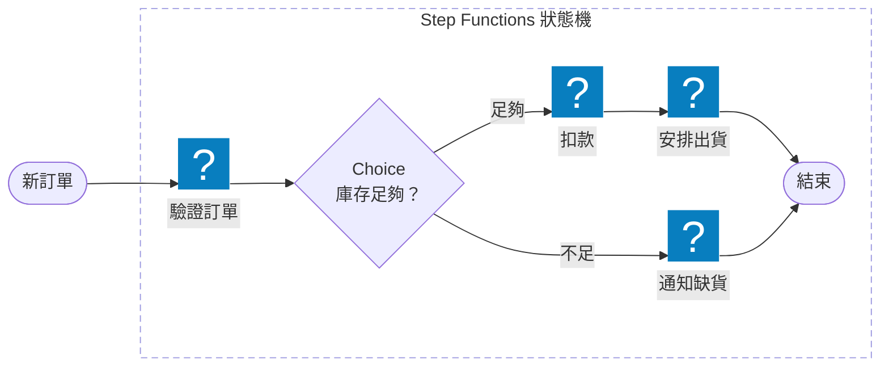

# 無伺服器運算：Lambda 與 Step Functions

第 2 章的 EC2 是一台由你自己管理的虛擬機。這一章介紹**完全不用管伺服器**的運算方式，包括由事件觸發的函式（Lambda），以及把多個步驟串成流程的服務（Step Functions）。

## 先備知識

- **無伺服器（Serverless）**
  - [【Serverless 應用案例賞析筆記】01. Serverless 架構與 Apache OpenWhisk](https://hackmd.io/@CynthiaChuang/Serverless-Use-Cases-Study-Notes-01)
  - [Day 01 - 萬里之行，始於足下：認識Serverless](https://ithelp.ithome.com.tw/m/articles/10235486)

- **編排（Orchestration）**
  - [Educative：What is serverless orchestration?](https://www.educative.io/answers/what-is-serverless-orchestration)
  - [iThome：Workflow Orchestration 流程編排介紹](https://ithelp.ithome.com.tw/articles/10381221)

## 什麼是無伺服器（Serverless）

「無伺服器」不是真的沒有伺服器，而是「**你不用管伺服器**」。建立伺服器、擴展、安裝更新，這些底層工作全部由 AWS 處理，你只要負責程式碼。而且**程式實際執行時才收費，閒置時不收費**。

和 EC2 比較：

```
EC2（有伺服器）                無伺服器（如 Lambda）
─────────────────              ─────────────────────
你租一台機器                   你上傳程式碼
自己裝環境、設定                AWS 負責底層
開著就計費（閒置也付費）        只在執行時付費
需要自己配置擴展               自動擴展
```

AWS 的無伺服器服務有兩個代表：**Lambda**（無伺服器運算）和 **Fargate**（無伺服器容器，下一章介紹）。

## AWS Lambda

Lambda 是一種 **FaaS（Function as a Service，函式即服務）**：你上傳一段程式（函式），事件觸發後 Lambda 就自動執行這段程式。整個過程你都不用管伺服器。

### 它解決什麼問題

用 EC2 時，你得讓一台伺服器**一直開著等**。就算它大部分時間都沒事做，你還是要付錢；流量變大時，擴展也要你自己處理。對於那種「偶爾才發生一次」的工作（有人上傳檔案時處理一下、每晚跑一次排程、支撐一個時有時無的 API），為了這種工作準備一台一直開著的機器，既浪費又麻煩。

Lambda 的做法完全相反：**你不用維護任何伺服器，程式只在被觸發時才執行，AWS 會自動擴展，你只為實際用到的運算付費。**

### 運作方式

```
設定觸發事件 → 事件發生 → Lambda 自動執行函式 → 按「呼叫次數 × 執行時間」計費

常見觸發事件：
  S3 有新檔案上傳
  收到 API Gateway 請求
  排定時間（定時任務）
  DynamoDB 資料變更
```

### 你需要設定的三件事

你不用碰伺服器，但要決定三個參數：

| 設定 | 說明 |
|---|---|
| **執行環境（Runtime）** | 選語言：Python、Node.js、Java、Go 等 |
| **記憶體** | 128 MB 到 10 GB |
| **逾時（Timeout）** | 這個函式最長能跑多久，**上限 15 分鐘** |

### 特性

| 特性 | 說明 |
|---|---|
| **自動擴展** | 大量事件同時湧入時，Lambda 會自動同時執行多個函式副本來處理（每個 Region 預設的並行上限約 1,000，可以申請調高） |
| **閒置不收費** | 沒有事件就不執行、不計費 |
| **內建高可用** | AWS 會自動在多個可用區執行函式，你不用自己處理 |
| **無狀態（Stateless）** | 每次執行都是獨立的，**不會保留上一次的資料**；需要保存的資料，要寫到外部服務，例如 S3 或 DynamoDB |

### 計費

Lambda 依兩個項目收費：呼叫次數 + 執行時間（時間再乘上你配置的記憶體大小）。執行時間還要再乘上你設定的記憶體大小。**函式沒有執行，就完全不收費**，因為它不需要一直開著等待。這正是 Lambda 和 EC2 最根本的差別。

### 一個具體例子：自動產生縮圖

```mermaid
architecture-beta
    group cloud(cloud)[AWS Cloud]

    service user(internet)[User]
    service s3in(aws:amazon-simple-storage-service-bucket)[S3 Bucket] in cloud
    service lambda(aws:aws-lambda-lambda-function)[AWS Lambda] in cloud
    service s3out(aws:amazon-simple-storage-service-bucket)[S3 Bucket] in cloud

    user:R --> L:s3in
    s3in:R --> L:lambda
    lambda:R --> L:s3out
```



1. 使用者把原圖上傳到 S3。
2. S3 收到新檔案，產生一個事件，觸發 Lambda。
3. Lambda 讀取原圖、產生縮圖，再把縮圖存回 S3。（上傳和存回的位置，可以是同一個 bucket 裡的不同路徑。圖中畫成兩個 S3 圖示，只是為了區分讀取和寫入。）

整個流程**沒有任何一台一直開著的伺服器**。平常沒人上傳，就完全不花錢；有人上傳時才執行，執行完就結束。這是「事件驅動」加上「無伺服器」最典型的例子。

### 限制

> **單次執行最長 15 分鐘**：需要長時間執行的工作，例如執行很久的批次工作或常駐服務，不適合用 Lambda。

> **冷啟動（Cold Start）**：函式很久沒被呼叫後，第一次啟動會有短暫的準備延遲。對絕大多數工作無感，但對「要求穩定極低延遲」的場景要留意。

## AWS Step Functions

Step Functions 是無伺服器的工作流程編排服務：將多個 Lambda 函式與 AWS 服務依順序、條件分支、平行串成一條視覺化流程，並自動處理步驟順序、重試與錯誤。

這條流程稱為**狀態機（state machine）**：每個步驟是一個「狀態」（state），再依條件決定下一步要進入哪個狀態。

**和單一 Lambda 的差別：** Lambda 是「一個步驟」；Step Functions 是「把多個步驟編排成完整流程」，無需自行撰寫串接、判斷、重試的膠合程式碼（glue code）。



*有 Lambda 圖示的步驟是 Task 狀態，每個都會呼叫一次 Lambda。菱形是 Choice 狀態，它不呼叫 Lambda，只根據「驗證訂單」的結果決定下一步。步驟之間怎麼串接、怎麼分支、失敗時怎麼重試，都由 Step Functions 負責。*

- 適合多步驟的業務流程，例如訂單處理、審批流程、機器學習的資料管線
- 同樣是無伺服器：不用管底層伺服器，按狀態轉換的次數計費

## 重點整理

- **無伺服器（Serverless）** = 不用管伺服器，底層由 AWS 全部處理；只在執行時付費，閒置不收費
- **Lambda**（FaaS）：事件觸發、自動擴展、閒置不收費；單次最長 **15 分鐘**，所以長時間的工作不適合，改用 EC2 或容器
- **Step Functions** = 無伺服器的工作流程編排，把多個 Lambda 或服務依順序、分支、重試串成視覺化流程；題目提到「協調」或「編排多個步驟」，就選它

| 情境需求 | 答案 |
|---|---|
| 事件觸發、短小任務、閒置不收費 | Lambda |
| 執行時間需超過 15 分鐘 | EC2 或容器（非 Lambda）|
| 串接多個步驟 / 服務、需條件分支與重試 | Step Functions |
