# 無伺服器運算：Lambda 與 Step Functions

第 2 章的 EC2 是自己管一台虛擬機；這章看「**完全不用管伺服器的運算方式**」——事件觸發的函式（Lambda）與多步驟流程編排（Step Functions）。

## 先備知識

- **無伺服器（Serverless）**
  - [【Serverless 應用案例賞析筆記】01. Serverless 架構與 Apache OpenWhisk](https://hackmd.io/@CynthiaChuang/Serverless-Use-Cases-Study-Notes-01)
  - [Day 01 - 萬里之行，始於足下：認識Serverless](https://ithelp.ithome.com.tw/m/articles/10235486)

- **編排（Orchestration）**
  - [Educative：What is serverless orchestration?](https://www.educative.io/answers/what-is-serverless-orchestration)
  - [iThome：Workflow Orchestration 流程編排介紹](https://ithelp.ithome.com.tw/articles/10381221)

## 什麼是無伺服器（Serverless）

「無伺服器」不是真的沒有伺服器，而是「**你不用管伺服器**」。底層的佈建、擴展、修補全部由 AWS 處理；你只負責程式碼，且**只在程式實際執行時才付費，閒置不收費**。

對比 EC2：

```
EC2（有伺服器）                無伺服器（如 Lambda）
─────────────────              ─────────────────────
你租一台機器                   你上傳程式碼
自己裝環境、設定                AWS 負責底層
開著就計費（閒置也付費）        只在執行時付費
需要自己配置擴展               自動擴展
```

AWS 的無伺服器服務有兩個代表：**Lambda**（無伺服器運算）與 **Fargate**（無伺服器容器，見下一章）。

## AWS Lambda

Lambda 是 **FaaS（Function as a Service，函式即服務）**：你上傳一段程式（函式），由事件觸發後自動執行，全程不用管伺服器。

### 它解決什麼問題

用 EC2 時，你得讓一台伺服器**一直開著等**——即使它大部分時間閒著沒事做，你也照樣付錢，而且流量變大時擴展要你自己處理。對於那種「偶爾才發生一次」的工作（有人上傳檔案時處理一下、每晚跑一次排程、支撐一個時有時無的 API），養一台常開的機器既浪費又麻煩。

Lambda 把這件事整個翻轉：**沒有要維護的伺服器、程式只在被觸發時才跑、擴展自動發生、你只為實際用到的運算付費。**

### 運作方式

```
設定觸發事件 → 事件發生 → Lambda 自動執行函式 → 按「呼叫次數 × 執行時間」計費

常見觸發事件：
  S3 有新檔案上傳
  收到 API Gateway 請求
  排定時間（定時任務）
  DynamoDB 資料變更
```

### 你需要設定的三件事

你不用碰伺服器，但要決定三個參數：

| 設定 | 說明 |
|---|---|
| **執行環境（Runtime）** | 選語言：Python、Node.js、Java、Go 等 |
| **記憶體** | 128 MB 到 10 GB |
| **逾時（Timeout）** | 這個函式最長能跑多久，**上限 15 分鐘** |

### 特性

| 特性 | 說明 |
|---|---|
| **自動擴展** | 事件大量湧入時，自動並行執行多個函式副本來消化（帳號預設有並行上限，約 1,000，可申請調高） |
| **閒置不收費** | 沒有事件就不執行、不計費 |
| **高可用內建** | AWS 自動跨多個可用區執行，你不用自己做 |
| **無狀態（Stateless）** | 每次執行都是獨立的，**不保留上一次的資料**；要保存狀態得寫到外部，如 S3 或 DynamoDB |

### 計費

Lambda 按兩個東西收費：**呼叫次數** + **執行時間**（時間再乘上你配置的記憶體大小）。**不執行就完全不收費**——沒有「開著等」的閒置成本，這正是它和 EC2 最根本的差別。

### 一個具體例子：自動產生縮圖

```mermaid
architecture-beta
    group cloud(cloud)[AWS Cloud]

    service user(internet)[User]
    service s3in(aws:amazon-simple-storage-service-bucket)[S3 Bucket] in cloud
    service lambda(aws:aws-lambda-lambda-function)[AWS Lambda] in cloud
    service s3out(aws:amazon-simple-storage-service-bucket)[S3 Bucket] in cloud

    user:R --> L:s3in
    s3in:R --> L:lambda
    lambda:R --> L:s3out
```



① 使用者上傳原圖至 S3 → ② S3 事件觸發 Lambda → ③ Lambda 讀原圖、產生縮圖、寫回 S3。（上傳與寫回可以是同一個 bucket 的不同路徑，圖中用兩個 S3 圖示分別表示讀取端與寫入端。）

整條流程**沒有一台常開的伺服器**：平常沒人上傳就零成本，一有上傳才跑、跑完就結束。這就是事件驅動 + 無伺服器最典型的例子。

### 限制
> **單次執行最長 15 分鐘**：需要長時間執行的工作（跑很久的批次工作、常駐的服務）不適合 Lambda。

> **冷啟動（Cold Start）**：函式很久沒被呼叫後，第一次啟動會有短暫的準備延遲。對絕大多數工作無感，但對「要求穩定極低延遲」的場景要留意。

## AWS Step Functions

Step Functions 是無伺服器的工作流程編排服務：將多個 Lambda 函式與 AWS 服務依**順序、條件分支、平行**串成一條視覺化流程，並自動處理步驟順序、重試與錯誤。這條流程叫**狀態機**：每個步驟是一個狀態，靠條件決定接下來跳到哪個狀態。

**與單一 Lambda 的差別：** Lambda 是「一個步驟」；Step Functions 是「把多個步驟編排成完整流程」，無需自行撰寫串接、判斷、重試的膠合程式碼。


*有 Lambda 圖示的是 Task 狀態，各呼叫一次 Lambda；菱形是 Choice 狀態，只依「驗證訂單」的結果決定走哪條路，本身不呼叫 Lambda。步驟之間的串接、分支與失敗重試都由 Step Functions 負責，不用自己寫膠合程式碼。*

- 適合：多步驟業務流程——訂單處理、審批流程、機器學習資料管線
- 同樣是無伺服器：不用管底層伺服器，按狀態轉換的次數計費

## 重點整理

- **無伺服器（Serverless）** = 不用管伺服器、AWS 全包、只在執行時付費；閒置不收費
- **Lambda**（FaaS）：事件觸發、自動擴展、閒置不收費；單次最長 **15 分鐘**——長時間工作不適合，改用 EC2 / 容器
- **Step Functions** = 無伺服器工作流程編排，把多個 Lambda / 服務依順序、分支、重試串成視覺化流程；看到「協調 / 編排多步驟」就是它

| 情境需求 | 答案 |
|---|---|
| 事件觸發、短小任務、閒置不收費 | Lambda |
| 執行時間需超過 15 分鐘 | EC2 或容器（非 Lambda）|
| 串接多個步驟 / 服務、需條件分支與重試 | Step Functions |
