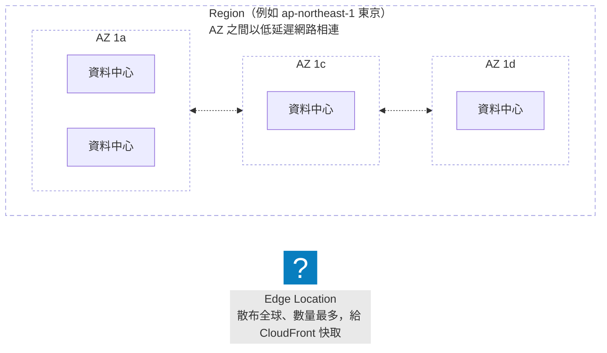
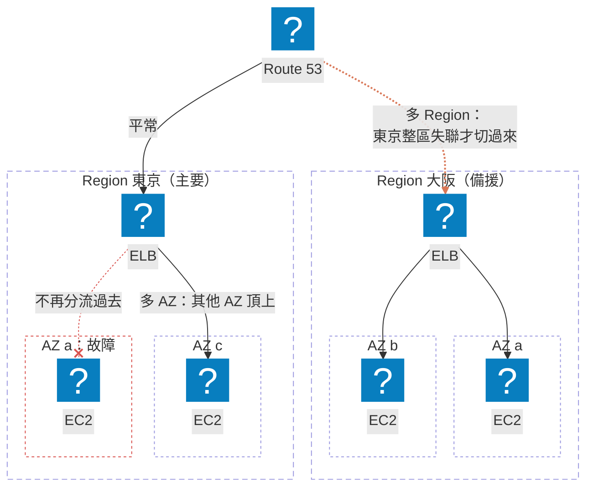
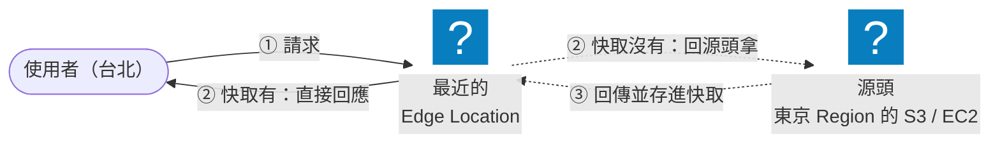

# 走向全球

選擇 Region、深入全球基礎設施，以及基礎設施自動化。第一章介紹過 Region / AZ / Edge 的基本概念，這章會講得更深入，並加上第一章沒講的「多 AZ 高可用 vs 多 Region 災難復原」，以及如何用自動化做一致的全球部署。

## 先備知識

- **CDN（內容傳遞網路）**
  - [什麼是 CDN？](https://www.twister5.com.tw/post/whatiscdn/)
  - [What is a CDN?（Cloudflare）](https://www.cloudflare.com/learning/cdn/what-is-a-cdn/)

- **YAML**
  - [什麼是 YAML？（Red Hat）](https://www.redhat.com/en/topics/automation/what-is-yaml)
  - [淺談YAML 格式- 伊恩的開發狂想](https://eandev.com/post/software/series/build-automated-deploy/yaml/)

## 為什麼要走向全球

把應用程式部署到全球多個地點，主要解決四件事：

1. **貼近使用者、降低延遲** — 各地使用者連到最近的據點，反應更快
2. **符合法規** — 某些資料依法必須留在特定國家 / 地區
3. **提高可靠性** — 把服務分散到多個獨立地點，一處出事不會全倒
4. **擴大觸及** — 幾分鐘就能在新地區開設據點，服務當地市場

## 選擇 AWS Region 的四個考量

把服務部署在哪個 Region，要綜合四個因素：

| 考量 | 說明 | 什麼時候是決定性因素 |
|------|------|-------------------|
| **法規與資料落地（Compliance）** | 法規要求資料存放在特定國家 / 地區 | 「資料依法必須留在某國」→ 直接決定 Region |
| **鄰近使用者（Proximity）** | 離主要使用者愈近，延遲愈低 | 「使用者集中在某地、要最低延遲」|
| **服務可用性（Feature availability）** | 新服務不是每個 Region 都立刻有 | 「要用某個較新服務」→ 先確認該 Region 有沒有 |
| **定價（Pricing）** | 各 Region 價格不同 | 「在符合前述條件下，挑最便宜的」|

## AWS 全球基礎設施

### Region（區域）

```
Region（區域，如 ap-northeast-1 東京）── 彼此獨立隔離
  └─ Availability Zone（可用區，一個 Region 通常 ≥ 3 個）
       └─ 一或多個實體資料中心

（另外散布全球、數量最多的）
Edge Location ── 給 CloudFront 等做快取
```

> **新圖提案（待審核）** — 審核通過後取代上方的文字圖。



*一個 Region 裡有多個 AZ，每個 AZ 由一或多個資料中心組成；AZ 之間實體隔離，但以低延遲網路相連。Edge Location 不屬於任何 Region，散布在全球各地，數量比 Region 多得多。*

全球各地的地理區域，彼此**完全獨立隔離**。資料預設不會自動跨 Region 移動——這同時是合規的保障（你的資料待在你選的地方）與設計上要注意的點（跨 Region 複製要自己設定）。

### Availability Zone（AZ）

AZ 是 Region 內一或多個實體資料中心的群組。同一 Region 的各 AZ **實體隔離**（不同建築、電力、網路），但彼此用低延遲高速網路相連。

> 若把應用程式只放在一個 AZ，那個 AZ 斷電 / 失火，服務就全掛。**跨至少兩個 AZ 部署，一個 AZ 出事時，其他 AZ 仍能服務**——這就是高可用性（High Availability）的基礎。


> 💡 這就是為什麼 ELB + Auto Scaling 通常會「跨多個 AZ」配置——把機器分散到不同 AZ，才真正達到高可用性（High Availability）。

### 多 AZ vs 多 Region

這兩個常被混用，但防範的災難等級不同：

| | 多 AZ（Multi-AZ）| 多 Region（Multi-Region）|
|--|---|---|
| **目的** | 高可用——一個 AZ 掛了，同 Region 其他 AZ 頂上 | 災難復原——整個 Region 失聯也能繼續服務 |
| **範圍** | 同一個 Region 內 | 跨地理區域（如 us-east-1 ＋ ap-northeast-1）|
| **成本** | 較低 | 較高（需在多 Region 複製資源）|
| **典型用途** | 一般高可用設計、資料庫備援 | 全球使用者、嚴格的 RTO／RPO 災難復原 |

> 「一個資料中心故障不能中斷」→ **多 AZ**
>
> 「整個區域因天災失聯也要繼續服務 / 服務全球使用者」→ **多 Region**。

> **新圖提案（待審核）** — 新增的圖，不取代任何內容。



*兩種故障，兩種應對。東京的 AZ a 故障時，ELB 不再把流量分過去，同一個 Region 的 AZ c 繼續服務，這是多 AZ。如果整個東京 Region 失聯，就要靠 Route 53 把使用者導到大阪的備援環境，這是多 Region；大阪那套環境和資料要事先複製好。*

### Edge Location（邊緣節點）

散布全球、數量遠多於 Region 的據點，把內容快取在離使用者近的地方。CloudFront（CDN）就是用它：

```
使用者（台北）→ 最近的 Edge Location
                ├─（快取命中）→ 直接回應，超快
                └─（快取沒有）→ 回源頭（如東京 Region 的 S3 / EC2）拿
```

> **新圖提案（待審核）** — 審核通過後取代上方的文字圖。



*使用者先連到最近的 Edge Location。快取裡有就直接回應；沒有的話才回東京 Region 的源頭拿，拿到後存進快取，下一個人就能直接命中。*

> 💡 CloudFront 的詳細快取行為屬於網路章節內容；這裡只記「Edge Location = 離使用者最近的快取據點」。

## 把 AWS 延伸到更靠近的地方

當「最近的 Region」還是不夠近，或必須放在自己的場地時，有三個延伸選項：

| 服務 | 用途 |
|------|-------|
| **AWS Local Zones** | 把運算 / 儲存放到更靠近大城市使用者的地方，進一步降低延遲 |
| **AWS Wavelength** | 把 AWS 服務嵌入電信 5G 網路邊緣，給行動裝置超低延遲 |
| **AWS Outposts** | 把 AWS 的硬體與服務搬進你自己的機房（地端用 AWS 的方式管理）|

## 基礎設施自動化

手動在主控台一個一個點選建立資源，容易出錯、難以重複、也難在多個 Region 複製同一套環境。解法是**基礎設施即程式碼（IaC，Infrastructure as Code）**。

| 服務 | 怎麼寫 IaC | 重點 |
|------|-----------|------|
| **AWS CloudFormation** | YAML / JSON 範本，宣告式 | AWS 原生 IaC；範本寫一次，一鍵部署整套環境 |
| **AWS CDK**（Cloud Development Kit）| Python、TypeScript 等程式語言 | 用熟悉的語言寫 IaC，底層自動產生 CloudFormation |

> 「要可重複、一致地部署整套基礎設施」「基礎設施即程式碼」「在多個 Region 部署相同環境」→ **CloudFormation**。
> 
> CLF 考 CDK 時通常問「用程式語言寫 IaC 是哪個服務」→ **CDK**。

**手動 vs IaC 對比：**

| | 手動建立 | IaC（CloudFormation / CDK）|
|--|---------|--------------------------|
| 流程 | 一個一個點，步驟靠記憶 | 範本 / 程式碼寫一次，一鍵部署整套 |
| 可重複性 | 難重現、容易漏設定 | 可重複、一致，多 Region 部署同一套 |
| 版本管理 | 沒有版本紀錄 | 可版本控制、可審查、可回滾 |

## 重點整理

- 走向全球的理由：降低延遲、符合法規、提高可靠性、擴大觸及
- 選 Region 四考量：**法規落地 > 鄰近使用者 > 服務可用性 > 定價**——法規通常最優先
- Region 彼此獨立隔離、資料預設不跨 Region；AZ 是 Region 內實體隔離但低延遲相連的資料中心群
- **多 AZ = 高可用**（一個 AZ 掛了同 Region 其他頂上）
- **多 Region = 災難復原 / 全球化**（整個 Region 失聯也能服務）
- **Edge Location** = 數量最多、離使用者最近的快取據點，CloudFront 用它降延遲
- 邊緣延伸：**Local Zones**（更近大城市）、**Wavelength**（電信 5G 邊緣）、**Outposts**（地端跑 AWS）
- **CloudFormation** = YAML/JSON 範本 IaC，可重複一致部署；**CDK** = 用程式語言寫 IaC（底層是 CloudFormation）

| 情境需求 | 答案 / 重點 |
|---------|-----------|
| 資料依法必須留在某國 | 選該國 Region（法規優先）|
| 使用者集中某地、要最低延遲 | 選鄰近的 Region |
| 一個資料中心故障也不能中斷服務 | 跨多個 AZ 部署 |
| 整個 Region 天災失聯也要繼續服務 | 多 Region 部署 |
| 把靜態內容放到離全球使用者最近處 | Edge Location / CloudFront |
| 要更靠近大城市使用者、再降延遲 | Local Zones |
| 行動裝置走 5G、要超低延遲 | Wavelength |
| 必須在自己機房用 AWS | Outposts |
| 可重複、一致地部署整套基礎設施 | CloudFormation（IaC）|
| 用程式語言（Python / TypeScript）寫 IaC | AWS CDK |
