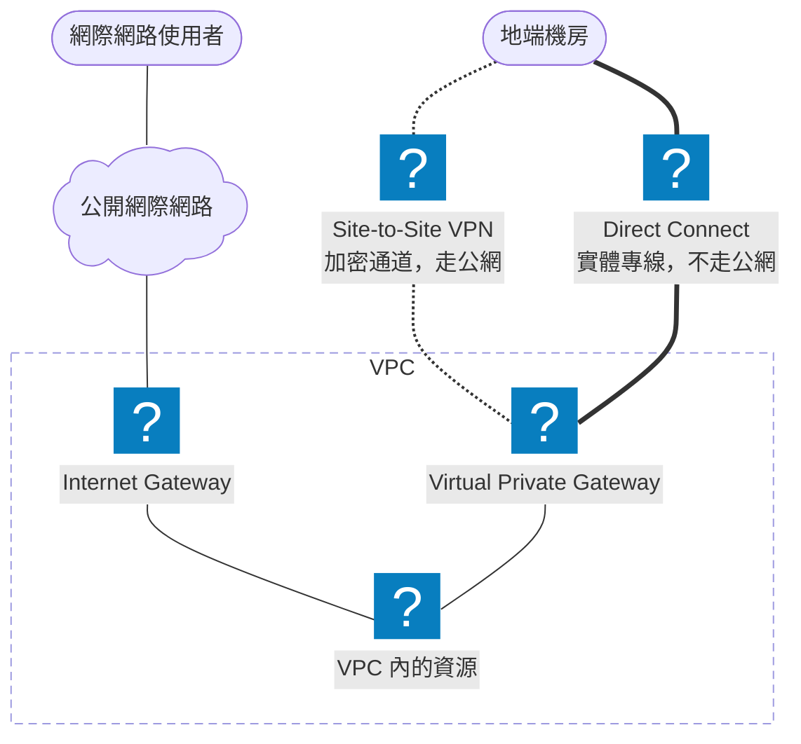

# 雲端網路

VPC、Subnet、各種連線方式、安全群組與 NACL，以及 AWS 的全球網路服務。

## 先備知識

- **IP 位址與 CIDR**
  - [What is an IP address?（Cloudflare）](https://www.cloudflare.com/learning/dns/glossary/what-is-my-ip-address/)
  - [CIDR 是什麼？標記格式與計算](https://inbound.technology/article/cidr)

- **ACL（存取控制清單，Access Control List）**
  - [第10 堂課：使用者管理與ACL 權限設定](https://linux.vbird.org/linux_basic_train/rockylinux9/unit10.php)

- **DNS（網域名稱系統）**
  - [什麼是 DNS？（Cloudflare）](https://www.cloudflare.com/zh-tw/learning/dns/what-is-dns/)

- **NAT（網路位址轉換）**
  - [NAT 伺服器設定](https://linux.vbird.org/linux_server/redhat9/0320nat.php)

## 網路在雲端裡是什麼

「網路」就是讓裝置之間能互相傳送資料的連線。在 AWS 上，你不會把伺服器直接放到網際網路上。你會先建立一個私人網路空間，這個空間只屬於你，和其他人隔離。接著再決定誰可以進來、誰可以出去，以及流量要走哪條路。這個私人網路空間就是 **VPC**。

> 可以把 AWS 想成一座超大型園區，VPC 則是你在裡面租下的一塊私人園地，四周有圍牆，只屬於你。園地裡的格局、道路和門禁，全部由你自己規劃。把網路設計好，是雲端安全的第一道防線。

## VPC 與 Subnet

### VPC（Virtual Private Cloud，虛擬私有雲）

建立 VPC 時，你要指定一段私有 IP 範圍，用 CIDR 表示，例如 `10.0.0.0/16`。你的 VPC 預設和其他客戶的 VPC 隔離，甚至和你自己的其他 VPC 也是隔離的。所以別人進不來，你的資源也不會暴露在外。

### Subnet：把 VPC 再分區

為什麼要把 VPC 切成更小的 Subnet？因為有些資源需要讓網際網路連進來，有些則不應該。最經典的設計是分成「Public」和「Private」兩層：

```
VPC（10.0.0.0/16）── 你的私人園區
│
├─ Public Subnet   10.0.1.0/24
│    └─ Web Server（需要被網際網路存取）
│
└─ Private Subnet  10.0.2.0/24
     └─ Database（絕不該讓網際網路直接碰到）
```

| Subnet 類型 | 說明 |
|---------|------|
| **Public Subnet** | 裡面的資源可以和網際網路來往（例如對外的網站伺服器）|
| **Private Subnet** | 裡面的資源不能被網際網路直接存取（例如資料庫），更安全 |

必須對外開放的資源（例如網站）和絕對不能對外的資源（例如資料庫）要分開放。這樣一來，就算網站被攻破，攻擊者也不能直接存取資料庫。這是「縱深防禦」（用多層防護保護重要資源）的基本做法。

> 📌 一個 Subnet 只屬於一個 AZ。如果要做到上一章說的「跨多個 AZ 的高可用」，就要在不同的 AZ 各建立一個 Subnet，再把資源分散放進去。

### Route Table（路由表）

每個 Subnet 都會關聯一張路由表。路由表就像園區裡的路標，寫著「要去某個目的地，應該走哪條路」。Public Subnet 的路由表裡有一條規則：「要去網際網路，就走 Internet Gateway」。Private Subnet 的路由表沒有這條規則，所以流量不能直接連到網際網路。這正是它稱為「私有」的原因。

### NAT Gateway

Private Subnet 沒有通往 Internet Gateway 的路由，所以流量出不去。但這會帶來一個實際的問題：Private Subnet 裡的資料庫或應用伺服器，有時還是需要**主動連到外部**，例如下載安全性更新。難道為了更新，就要把它搬到 Public Subnet，暴露在網際網路上嗎？

不需要。**NAT Gateway** 就是為了解決這個問題。它放在 Public Subnet 裡，代替 Private Subnet 的資源連到網際網路。

```mermaid
architecture-beta
    group vpc(cloud)[VPC]
    group pub(cloud)[Public Subnet] in vpc
    group priv(cloud)[Private Subnet] in vpc

    service db(database)[DB] in priv
    service nat(aws:amazon-vpc-nat-gateway)[NAT Gateway] in pub
    service igw(aws:amazon-vpc-internet-gateway)[Internet Gateway] in vpc
    service internet(internet)[Internet]

    db:R --> L:nat
    nat:R --> L:igw
    igw:R <--> L:internet
```



*Private Subnet 裡的 DB 需要更新時，會主動經過 NAT Gateway 和 IGW 連到網際網路。反過來，網際網路上的人無法主動連進來存取 DB。*

關鍵在於**連線是由哪一邊發起的**：
- ✅ Private Subnet 主動連到外部（例如下載更新）：可以
- ❌ 網際網路主動連進 Private Subnet：會被擋下

NAT Gateway 是有狀態（Stateful）的。DB 發起連線後，NAT Gateway 會記錄這個連線，所以回應的資料可以照原路送回 DB。如果網際網路上有人想直接對 DB 發起一個新連線，NAT Gateway 找不到對應的連線紀錄，就會直接丟棄這個請求。

家裡的 Wi-Fi 分享器也是用同樣的 NAT 機制：你可以瀏覽任何網站，因為回應資料能送回來；但外面的人無法主動連進你的筆電。

## 連到 AWS 的方式

建立好 VPC 之後，接著要決定兩件事：外部的使用者怎麼連進來，以及地端機房怎麼和 VPC 連線：



*圖中有三條彼此獨立的連線路徑。網際網路使用者經過公開網際網路，從 Internet Gateway 進入 VPC。地端機房則有兩種選擇：Site-to-Site VPN（虛線，在公開網路上建立加密通道），或 Direct Connect（粗線，不經過公開網路的實體專線）。這兩種連線在 VPC 這一端，都接到 Virtual Private Gateway（虛擬私有閘道）。*

| 連線方式 | 走公網嗎 | 特性 | 適合 |
|---------|---------|------|------|
| **Internet Gateway** | 是（公開）| 讓 VPC 連上公共網際網路 | 對外的網站、API |
| **Site-to-Site VPN** | 是（但加密）| 加密通道、便宜、快上線、延遲不保證 | 臨時 / 成本敏感的地端連線 |
| **Direct Connect** | 否（專線）| 私有實體線路、穩定、低延遲、較貴；**不加密**† | 大量 / 敏感資料、長期穩定連線 |

> † **Direct Connect 不內建加密**：專線的流量不經過公開網路，但線路本身並沒有加密。如果需要加密，要在 Direct Connect 上再加一層 VPN（DX + VPN）。記住：「私有專線 ≠ 自動加密」。

> **VPN vs Direct Connect**：兩者都能把地端連到 AWS，差別在於 VPN 是在公開網路上加密，Direct Connect 則是實體專線。
> - 題目強調「**加密、便宜、快速建立**」：選 **VPN**
> - 題目強調「**穩定頻寬、低延遲、不走公網、專屬連線**」：選 **Direct Connect**

## VPC 之間的連通

### VPC Peering

VPC Peering 讓兩個 VPC 直接互通，就像在兩個私人園地之間開一扇門。同一個 Region 或跨 Region 都可以建立。

要特別注意一個限制：**VPC Peering 不可傳遞（non-transitive）**。

```mermaid
architecture-beta
    service vpcA(aws:amazon-vpc-virtual-private-cloud-vpc)[VPC A]
    service vpcB(aws:amazon-vpc-virtual-private-cloud-vpc)[VPC B]
    service vpcC(aws:amazon-vpc-virtual-private-cloud-vpc)[VPC C]

    vpcA:R <--> L:vpcB
    vpcB:R <--> L:vpcC
```



*A 和 B 之間、B 和 C 之間，各自建立了一條 Peering。但 A 無法透過 B 連到 C。如果想讓 A 和 C 互通，必須再建立一條 A 和 C 之間的 Peering。*

### Transit Gateway

VPC 一多，如果每兩個 VPC 都要建一條 Peering，需要的連線數量會快速增加：10 個 VPC 就要 45 條。**Transit Gateway** 是一個中央交換中心（hub），所有 VPC 和地端網路（VPN / Direct Connect）都連到它。這種架構稱為 hub-and-spoke，流量可以集中管理。


*VPC A、B、C 和地端網路都連到同一個 Transit Gateway，透過這個中央 hub 互相連通，不必再每兩個建立一條 Peering。不同帳號的 VPC 也可以共用同一個 Transit Gateway。*

### VPC Endpoints

VPC Endpoint 讓 **Private Subnet 裡的資源直接存取 AWS 服務（例如 S3）**，而且流量不會離開 AWS 的內部網路。這樣就不需要 Internet Gateway，也不需要 NAT Gateway。

```mermaid
architecture-beta
    group vpc(cloud)[VPC]
    group priv(cloud)[Private Subnet] in vpc

    service resource(server)[App] in priv
    service endpoint(aws:amazon-vpc-endpoints)[VPC Endpoint] in vpc
    service s3(aws:amazon-simple-storage-service-bucket)[S3]

    resource:R --> L:endpoint
    endpoint:R --> L:s3
```



Private Subnet 裡的 App 透過 VPC Endpoint 直接連到 S3，全程都在 AWS 的內部網路裡。和前面的 NAT Gateway 相比，這種做法不需要繞到 Public Subnet，也不需要經過 Internet Gateway，完全不會碰到公開網路。

VPC Endpoint 分成兩種。它們的差別在於，流量是用什麼方式送到 AWS 服務：

- **Gateway Endpoint**：在路由表裡加一條規則：「要去 S3，就走這個 Gateway Endpoint」。這和 Public Subnet 的路由表寫「要去網際網路，就走 Internet Gateway」是同一種做法，所以名字裡也有 Gateway。它只支援 S3 和 DynamoDB，而且免費。
- **Interface Endpoint**：在你的 Subnet 裡建立一個網路介面，這個網路介面有自己的私有 IP。程式連到這個 IP，就能存取 AWS 服務。大多數 AWS 服務都支援這種做法，背後用的技術叫做 **PrivateLink**，要依使用時間和傳輸的資料量付費。

| 類型 | 怎麼運作 | 支援服務 | 費用 |
|------|---------|---------|------|
| **Gateway Endpoint** | 路由表裡的一條規則 | S3、DynamoDB | 免費 |
| **Interface Endpoint**（PrivateLink）| Subnet 裡的私有 IP | 大多數 AWS 服務 | 有費用 |

> 📌 題目提到「Private Subnet 要存取 S3，但不想走公網，也不想經過 NAT Gateway」：選 **VPC Endpoint（Gateway）**。

---

## 網路安全：Security Group 與 NACL

資源放進 Subnet 之後，要控制「什麼流量能進、能出」。

```mermaid
architecture-beta
    group vpc(cloud)[VPC]
    group subnet(cloud)[Subnet] in vpc
    group sg[Security Group] in subnet

    service internet(internet)[Internet]
    service igw(aws:amazon-vpc-internet-gateway)[Internet Gateway]
    service nacl(aws:amazon-vpc-network-access-control-list)[NACL] in vpc
    service ec2(aws:amazon-ec2-instance)[EC2] in sg

    internet:R --> L:igw
    igw:R --> L:nacl
    nacl:R --> L:ec2
```



流量要進入 Subnet 之前，先由 NACL 檢查；進入 Subnet 之後，還要再通過 EC2 的 Security Group，才會真正到達 EC2。

### Security Group（安全群組）：執行個體層級、有狀態

- **執行個體層級**：直接套用在 EC2 上，是離機器最近的一道防線
- **有狀態（Stateful）**：只要允許某個流量進來，它的**回應流量就會自動放行**，不必另外設定規則。就像門口的保全記得「這個人是我放進來的」，他要出去時自然會放行
- **只能設定允許規則**：沒有被允許的流量會自動擋掉，但你無法設定「拒絕」規則

### Network ACL（NACL）：Subnet 層級、無狀態

- **Subnet 層級**：設在 Subnet 的邊界，Subnet 裡的所有資源都受它控管
- **無狀態（Stateless）**：進來和出去的流量**分開檢查**。你允許流量「進來」，不代表回應可以「出去」，必須另外允許回應流量。就像社區門口的哨兵不記得誰剛進來，車子要出去時，得再檢查一次
- **允許和拒絕規則都能設定**：規則依編號由小到大逐條比對，適合用來封鎖特定的 IP

### Security Group vs NACL

| 比較 | Security Group | Network ACL（NACL）|
|------|---------------|-------------------|
| **守備層級** | 執行個體（單台機器）| Subnet（整個 Subnet 邊界）|
| **狀態** | **有狀態**：回應自動放行 | **無狀態**：進出分開、回應要另開規則 |
| **規則類型** | 只有**允許**（allow）| **允許 + 拒絕**（allow / deny）|
| **規則比對** | 全部規則一起看 | 依編號由小到大逐條，先符合先生效 |
| **預設行為** | 入站全擋、出站全通 | 自建的全擋（要自己加規則）；VPC 預設的 NACL 則全部允許 |
| **像什麼** | 機器門口的保全 | 社區門口的哨兵 |

> 1. **層級**：Security Group 套用在執行個體，NACL 套用在 Subnet
> 2. **狀態**：Security Group 有狀態（回應自動放行），NACL 無狀態（回應要自己設定規則）
> 3. **拒絕規則**：只有 NACL 能明確「拒絕」；Security Group 只能「允許」
>
> 📌 「要封鎖某個特定 IP 位址」→ NACL（Security Group 寫不出拒絕規則）。

## 全球網路：Route 53 與 CloudFront

最後介紹兩個服務。它們負責在全球範圍內，把流量導到正確的地方，並加快內容傳送的速度。

### Amazon Route 53（DNS 服務）

Route 53 是 AWS 的 **DNS（Domain Name System，網域名稱系統）** 服務。DNS 就像網路的電話簿：使用者輸入 `www.example.com`，DNS 會把這個名稱轉換成伺服器的 IP 位址，瀏覽器才知道要連到哪裡。

除了轉換名稱，Route 53 還能：
- **註冊網域**：直接在 AWS 購買網域名稱
- **設定路由政策**：依延遲把使用者導到最快的據點、依地理位置把不同國家的使用者導到不同的伺服器，或依權重分配流量

> 💡 Route 53 常和 CloudFront、ELB 搭配使用：DNS 先把使用者導到最近或最適合的入口，再由 CDN 或負載平衡器處理後續的流量。

### Amazon CloudFront（CDN）

CloudFront 是 AWS 的 **CDN（Content Delivery Network，內容傳遞網路）**。

```
使用者（台北）→ 最近的 Edge Location
                ├─（快取有）→ 直接回應，超快
                └─（快取沒有）→ 回源頭（origin，如 S3 / EC2）拿，再快取
```

- 適合：圖片、影片、靜態網站、串流等需要快速傳送給全球使用者的內容
- 好處：大幅降低延遲，也能減輕源頭伺服器的負擔

> 📌 **解題方向**
> - 題目提到「把內容快取到離全球使用者最近的地方、降低延遲」：選 **CloudFront**
> - 題目提到「把網域名稱解析成 IP」或「依延遲、地理位置導流」：選 **Route 53**

## 封包的完整旅程

回到這一章開頭的目標：一個封包從網際網路出發，要經過哪些關卡才會到達一台 EC2？現在所有元件都介紹過了，把它們依序串起來：

```
使用者請求
   ↓
Internet Gateway   VPC 的對外大門
   ↓
Route Table        路標：這段流量該送去哪個 Subnet
   ↓
NACL               Subnet 哨點：這個來源 / Port 允不允許進？（無狀態）
   ↓
Security Group     機器保全：這台 EC2 允不允許這個流量？（有狀態）
   ↓
EC2 執行個體       抵達目的地
```

1. 使用者的請求從網際網路進來，先到達 **Internet Gateway**。
2. **Route Table** 決定流量要送到哪個 Subnet。
3. 到了 Subnet 的邊界，**NACL** 逐條檢查是否允許進入。（NACL 無狀態，所以之後的回應還要再檢查一次。）
4. 到了 EC2 門口，**Security Group** 確認是否允許這個流量。（Security Group 有狀態，所以回應會自動放行。）
5. 兩道防線都放行後，封包才真正到達 **EC2**。

**回程**：EC2 送出回應時，Security Group 有狀態，會自動放行；但 NACL 無狀態，必須事先設定好允許回應流量出去的規則，回應才能離開 Subnet。

## 重點整理

- **VPC** = 你在 AWS 上隔離的私人網路，建立時要指定 CIDR（如 `10.0.0.0/16`）
- Subnet 分成**公有**（可連網際網路）與**私有**（不能被外網直接存取，用來放資料庫等）；一個 Subnet 只屬於**一個 AZ**
- **Route Table** 決定 Subnet 的流量往哪裡送（Public Subnet 有通往 IGW 的路由，Private Subnet 沒有）
- **NAT Gateway** = 讓 Private Subnet 可以主動連到網際網路（如下載更新），但外部無法主動連進來
- 三種連線方式：**Internet Gateway**（連公網）、**VPN**（在公網上加密，便宜、建立快）、**Direct Connect**（實體專線，穩定、低延遲、不走公網、較貴）
- **Security Group vs NACL** 四組對比：
  1. 層級：Security Group 套用在執行個體，NACL 套用在 Subnet
  2. 狀態：Security Group 有狀態（回應自動放行），NACL 無狀態（回應要另外設定規則）
  3. 規則：Security Group 只能允許；NACL 可以允許也可以拒絕（依編號由小到大比對）
  4. 預設：Security Group 入站全擋、出站全通；自建的 NACL 全擋，要自己加規則
- **Route 53** = DNS 服務：把網域解析成 IP、註冊網域、依延遲 / 地理位置 / 權重設定路由
- **CloudFront** = CDN：用 Edge Location 快取內容，降低全球使用者的延遲
- **VPC Peering**：兩個 VPC 直接互通；不可傳遞（A↔B、B↔C，A 仍然連不到 C）
- **Transit Gateway**：用 hub-and-spoke 架構集中連通多個 VPC，也能連到地端
- **VPC Endpoint（Gateway）**：Private Subnet 不走公網，直接存取 S3 / DynamoDB，免費

| 情境需求 | 答案 |
|---------|------|
| 在雲端圈一塊隔離的私人網路 | **VPC** |
| 資料庫不該被網際網路直接存取 | 放 **Private Subnet** |
| 讓 VPC 連上公共網際網路 | **Internet Gateway** |
| Private Subnet 要下載更新，但不被外網存取 | **NAT Gateway** |
| 地端連 AWS、加密、便宜、快上線 | **VPN** |
| 地端連 AWS、專線、穩定低延遲 | **Direct Connect** |
| 控制單一台 EC2 的進出流量 | **Security Group**（有狀態）|
| 在 Subnet 邊界明確封鎖某個 IP | **NACL**（無狀態、可寫拒絕規則）|
| 把網域名稱解析成 IP / 智慧導流 | **Route 53** |
| 把內容快取到離使用者最近處降延遲 | **CloudFront** |
| 兩個 VPC 互通 | **VPC Peering** |
| 多個 VPC 集中互通 / 同時連地端 | **Transit Gateway** |
| Private Subnet 存取 S3 不走公網 | **VPC Endpoint（Gateway）** |
